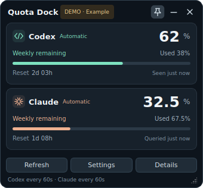

# Quota Dock

**A compact Ubuntu desktop widget for Codex and Claude subscription usage.** See your weekly allowance, usage percentage and next reset time in one small window. Launch it from the application menu and let it start automatically when you sign in.

Python · PySide6/Qt · Version **1.2.1** · [MIT License](LICENSE)



The screenshot uses **demo data**, not a real account. The default window is 340 × 316 pixels.

## Features

- Weekly **remaining allowance** and **usage percentage** for Codex and Claude, with short-term limits when available.
- A usage check at startup, followed by automatic checks every **60 seconds** by default. Configure each service independently.
- The next reset time, a countdown and the time of the last reading.
- Separate notifications for a **scheduled reset** and **recovery confirmed by a new reading**.
- Application-menu launch, single-instance behaviour, login autostart and an always-on-top option.
- Independent Claude usage checks, plus an optional bridge to an existing Claude status line.
- Clear handling of failed checks, missing authentication and stale readings. Unknown usage is never presented as zero.
- A demo that needs no account, and command-line diagnostics that do not require the main window.

Quota Dock polls for usage updates. Service caches, network conditions and retry delays can postpone a fresh reading; it does not promise continuous, second-by-second synchronisation.

## Requirements

| Component | Requirement |
| --- | --- |
| Operating system | Ubuntu desktop. Written for 22.04, 24.04 and 26.04; physical desktop validation is still needed for each release |
| Python | 3.10 or later |
| Display | An X11 or Wayland desktop capable of running Qt |
| GUI dependency | `PySide6-Essentials>=6.8,<7`, installed during setup |
| Codex | A Codex CLI that supports `account/rateLimits/read`, signed in with a ChatGPT subscription account |
| Claude | **Claude Code 2.1.306 or later**, a subscription login that exposes usage, and automatic checks enabled |
| Internet | Required for the initial Qt download and online usage checks |

Install and sign in to each CLI under the same Ubuntu user account before connecting the widget. Quota Dock does not install the CLIs or sign in on your behalf. See the [Codex CLI documentation](https://developers.openai.com/codex/cli/) and [Claude Code setup guide](https://code.claude.com/docs/en/setup).

Claude checks use an **experimental `get_usage` control interface verified with version 2.1.306**. Compatibility with later CLI versions is not guaranteed. An incompatible response is reported as an error or unsupported state. See [How Claude usage checks work](docs/CLAUDE_AUTO_QUERY.md).

## Installation

### Install from a source ZIP or Git clone

This repository contains source code, documentation, tests and build configuration. Generated packages, virtual environments and personal settings are excluded.

Prepare the Ubuntu system dependencies:

```bash
sudo apt update
sudo apt install python3 python3-venv xkb-data \
  libxkbcommon0 libxkbcommon-x11-0 libxcb-cursor0 libegl1 libgl1 libnotify-bin
```

After extracting the ZIP or cloning the repository, open the **project directory containing `install.sh`** and run:

```bash
bash install.sh
```

Run this script as your normal user, without `sudo`. It installs the app and Qt in a user-specific virtual environment rather than modifying the system Python environment. The first installation needs internet access.

When installation finishes, open **Quota Dock** from the Ubuntu application menu. Routine use does not require a terminal or a Bash window. To launch it from a terminal:

```bash
"$HOME/.local/bin/quota-widget"
```

### Install a Debian package

If the repository maintainer has attached a `.deb` file to **GitHub Releases**, download it and open it with a software installer, or run:

```bash
sudo apt install ./quota-dock_1.2.1_all.deb
```

Launch **Quota Dock 1.2.1** or **Quota Dock** from the application menu and wait for initial preparation to finish. The launcher downloads Qt into your own runtime environment, so the first launch also needs internet access. The package architecture `all` does not guarantee that Qt wheels are available for every processor.

To build the package yourself, see [Development and builds](#development-and-builds) and the [release guide](docs/RELEASING.md).

### Upgrade an existing installation

Close the running widget first. For a source installation, run `bash install.sh` from the new source directory. For a package installation, install the new `.deb` and launch the app again. Using the same user account and XDG environment preserves your settings, readings and autostart preference.

**Version 1.2.1 changes the application and documentation to English.** The version increase also ensures that the Debian launcher replaces an existing 1.2.0 runtime instead of continuing to use its older interface.

Previously saved Claude readings and pending notifications also display English text. This presentation update preserves usage values, observation times, reset times and notification delivery history. Translating a session label does not make an old observation appear fresh.

If an old source-installation shortcut still opens the previous app after you switch to the Debian package, press **Alt+F2** in GNOME and run `/usr/bin/quota-widget` once. The app updates the desktop and autostart entries it owns to use the new launcher.

## First launch

1. Open **Settings** and check the paths to the Codex and Claude executables. If a CLI works in your terminal but the widget cannot find it, enter the absolute path reported by `command -v codex` or `command -v claude`.
2. Make sure automatic Claude usage checks are enabled. They are enabled by default.
3. Adjust **Start at login** if needed. The first normal GUI launch enables it automatically; a later decision to disable it is preserved.
4. With valid CLI logins and network access, the widget starts checking usage immediately. You do not need to keep a Claude conversation or terminal window open.

If the widget reports that sign-in is required, authenticate the relevant CLI:

```bash
# If Codex needs authentication
codex login

# If Claude needs authentication
claude auth login
```

Autostart runs **when you sign in to your desktop**, not before login as a system service. Usage checks and notifications do not run while the computer is shut down or suspended. Demo and diagnostic commands do not register first-run autostart.

## Understanding the readings

### The large percentage means remaining allowance

| Display | Example | Meaning |
| --- | --- | --- |
| Large percentage | `32.5%` | The percentage of the weekly allowance remaining |
| `Used` | `67.5%` | Usage within that same allowance |
| Reset time | Your computer's local time | The next reset time supplied by the service |
| Previous reading or error status | The earlier value and its timestamp | The value has not been confirmed by a new successful reading |

**When comparing Claude's `Current week (All models)` with the widget, compare it with `Used`.** Automatic checks use `seven_day`, the weekly allowance across all models. They do not add together model-specific percentages. A model-specific limit can be a separate restriction. Check that the account, observation time and weekly period also match.

Codex limits are classified by their duration, not simply by whether they are named `primary` or `secondary`. Multiple allowances are displayed separately and are not added together.

### Data sources and intervals

| Service or mode | Data source | Default interval and conditions |
| --- | --- | --- |
| Codex | `account/read` and `account/rateLimits/read` through the local CLI App Server | 60 seconds; configurable from 30 to 900 seconds |
| Claude automatic checks | `initialize` and `get_usage(skip_behaviors: true)` control requests to a separate CLI process | 60 seconds; configurable from 60 to 900 seconds |
| Claude session mode | A local bridge receiving Claude Code's `statusLine` JSON | Depends on observations supplied by session callbacks |

The two automatic providers run independently. Following a completed successful check, the next check waits for the configured interval. Failures increase the retry delay. Claude's recent cache and retry delays are respected, and manual refresh does not guarantee a new server reading.

### Notifications

- **Scheduled reset:** the last reported reset time has arrived.
- **Confirmed recovery:** a new successful observation indicates that an allowance has recovered.

The clock passing a scheduled time does not establish that usage has reset. Recovery of one allowance also does not establish that every model or operation is available. Desktop notification settings affect delivery.

### Optional Claude session mode

Disable automatic Claude checks and use the session-connection controls in **Settings** to use the status-line bridge. This changes `statusLine` in your Claude user settings, saves the previous command and forwards its output. Disconnecting restores the earlier setting unless a subsequent external edit would be overwritten.

Session mode displays the latest valid weekly observation supplied by a session. An idle callback does not necessarily fetch fresh server usage. After switching to automatic checks, disconnect an unnecessary session bridge to stop its additional callbacks. Disconnecting the bridge and disabling automatic checks are separate operations.

## Frequently asked questions

### Do usage checks consume model usage?

The widget does not send a user prompt or create a model conversation turn to check usage. It sends account-limit read requests to Codex and usage-control requests to Claude. It is therefore not designed to spend inference tokens on monitoring.

Authentication refresh, usage-network requests, CLI execution and local state writes can still occur. Service request limits and caches still apply. API-key billing and subscription allowances are different measurements.

### Does it put significant wear on an SSD?

A one-second display update is not a one-second disk write. Re-evaluating the same observation does not repeatedly save alarm state, but new results, observation timestamps and notification records are saved as small JSON files. The current implementation uses atomic replacement and `fsync`, so **it does perform disk writes**. Each CLI can make additional writes of its own.

The implementation does not provide evidence of substantial SSD wear from the default one-minute interval, but total writes on your device have not been measured. Changing both intervals to 300 seconds reduces the nominal number of scheduled checks by 80%, at the cost of slower usage and recovery confirmation. It does not imply an 80% reduction in physical NAND writes. See [Resource use and storage writes](docs/RESOURCE_USAGE.md).

### Why is Claude's usage different from the official screen, or unavailable?

Compare **weekly usage across all models** for the same account, and remember that the widget's large figure is the remaining percentage. CLI caching, an older displayed observation or a network failure can also explain a difference. Check the connection diagnostics in **Settings**, the executable path, the Claude version and `CLAUDE_CONFIG_DIR`. See [Troubleshooting](docs/TROUBLESHOOTING.md).

### What if I see `Failed to create XKB context`?

Before creating the GUI, the app locates XKB keyboard data and supplements its process environment. If the error persists, use `--check-gui` and follow the [XKB troubleshooting steps](docs/TROUBLESHOOTING.md) to check the data path and `xkb-data` installation.

## Demo and diagnostics

These examples use the source-installation launcher. For a Debian package installation, replace `"$HOME/.local/bin/quota-widget"` with `/usr/bin/quota-widget`.

```bash
# Demo data; no account connection
"$HOME/.local/bin/quota-widget" --demo

# XKB and display environment only; no GUI or service connection
"$HOME/.local/bin/quota-widget" --check-gui

# Codex and the currently selected Claude mode
"$HOME/.local/bin/quota-widget" --check

# Claude only
"$HOME/.local/bin/quota-widget" --check-claude
```

`--check`, and `--check-claude` when automatic checks are enabled, may send real usage requests through the installed CLIs. They do not send model prompts. The GUI's connection-diagnostics window only inspects existing local and in-memory state.

## Data and privacy

| Data | Default location |
| --- | --- |
| Settings and autostart preference | `~/.config/quota-widget/` |
| Usage observations, alarms and bridge state | `~/.local/state/quota-widget/` |
| Login autostart entry | `~/.config/autostart/quota-widget.desktop` |
| Source installation and virtual environment | `~/.local/share/quota-widget/` |
| Debian package's per-user runtime | `~/.local/share/quota-dock/runtime/` |

The app supports `XDG_CONFIG_HOME`, `XDG_STATE_HOME` and `XDG_DATA_HOME`. Use `QUOTA_WIDGET_DATA_DIR` to override its observation-state directory. If you use a custom Claude configuration, keep `CLAUDE_CONFIG_DIR` consistent when installing, running and removing a session bridge.

The widget does not directly read authentication-token files or browser cookies; the installed CLIs handle authentication. For Claude account matching and cache freshness, it reads a limited set of account and usage metadata from `.claude.json`. The widget has no telemetry-upload feature of its own, but it does not control each CLI's separate network and storage policies. See [Security and privacy](SECURITY.md).

## Development and builds

Prepare a development environment in the project root:

```bash
python3 -m venv .venv
source .venv/bin/activate
python -m pip install -e . -r requirements-dev.txt

# Run tests without service accounts
make test

# Open the demo
python -m quota_widget --demo

# Build a wheel and source distribution
make build

# Build the Ubuntu package; requires dpkg-deb
make deb
```

Build outputs go into `dist/`, which is excluded from Git. A normal GUI run can register application-menu and autostart entries, so use `--demo` for interface development. Disconnect a session bridge that uses your development environment before deleting or moving that environment.

GitHub Actions is configured to run tests and package checks on Ubuntu 22.04/Python 3.10 and Ubuntu 24.04/Python 3.12. Check the actual runs in **Actions** after uploading the repository. Providing the workflow files is not evidence that the remote jobs have passed.

See [CONTRIBUTING.md](CONTRIBUTING.md) for development principles, [Validation](docs/VALIDATION.md) for recorded checks and their limits, and [CHANGELOG.md](CHANGELOG.md) for release history.

### Project layout

| Path | Purpose |
| --- | --- |
| `quota_widget/` | Native interface, providers, parsing, state, notifications, startup and diagnostics |
| `quota_widget/assets/` | Application icon |
| `tests/` | Automated tests using synthetic data, temporary directories and mock CLIs |
| `packaging/` | Debian builder, desktop entry and first-run preparation launcher |
| `docs/` | Setup, troubleshooting, provider details, resource use, validation, release instructions and demo image |
| `.github/` | CI workflows and Issue/Pull Request templates |
| `install.sh`, `uninstall.sh` | Per-user installation and removal |
| `pyproject.toml`, `MANIFEST.in` | Python package metadata and source-distribution contents |
| `Makefile`, `requirements-dev.txt` | Test/build commands and development tools |

## Uploading to GitHub

The suggested repository name is **`quota-dock`**. Create an empty GitHub repository without automatically generating a README, licence or gitignore, then push the extracted project root. Those files are already included.

The [first-upload guide](docs/GITHUB_SETUP.md) explains the initial commit, remote URL, push and Actions checks. Replace the account-name placeholder with your own account or organisation.

## Removal

If you use the optional Claude session bridge, disconnect it first. Disable login autostart, then close the widget.

- **Source installation:** run `bash uninstall.sh` from the project directory.
- **Debian package:** remove it through your software manager or run `sudo apt remove quota-dock`.

Settings and observations are preserved. The source uninstaller stops if it cannot restore the previous status-line setting, so that you can resolve the conflict before removing the app.

## References and licence

- [OpenAI Codex App Server: accounts and rate limits](https://learn.chatgpt.com/docs/app-server)
- [Claude Code CLI](https://code.claude.com/docs/en/cli-reference)
- [Claude Code status line](https://code.claude.com/docs/en/statusline)
- [Claude Agent SDK changelog: experimental usage access](https://github.com/anthropics/claude-agent-sdk-typescript/blob/main/CHANGELOG.md)
- [Qt for Python](https://doc.qt.io/qtforpython-6/)

Quota Dock is not an official OpenAI or Anthropic product. Project code is available under the [MIT License](LICENSE). PySide6/Qt and the service CLIs have their own licences. This repository does not redistribute Codex, Claude CLI or Qt binaries.
